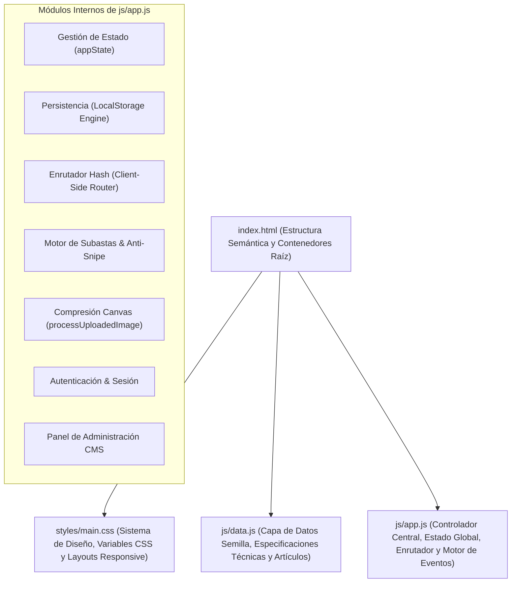
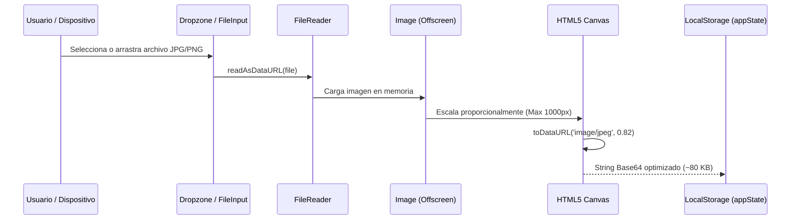

# Documento Técnico de Arquitectura y Desarrollo: Plataforma Web de Subastas de Vehículos Clásicos (RetroMotors)

---

## 1. Resumen Ejecutivo (Abstract)

El presente documento expone la arquitectura técnica, el diseño de interacción, los algoritmos implementados y las decisiones de ingeniería detrás del desarrollo de **RetroMotors**, una plataforma web orientada a la subasta en tiempo real, catalogación y peritaje forense de automóviles clásicos y piezas de colección histórica. 

Construida bajo el paradigma de **Single Page Application (SPA) nativa**, la solución prescinde intencionalmente de frameworks pesados o dependencias externas complejas de terceros, sustentándose exclusivamente en **HTML5 semántico**, **Vanilla CSS3 con diseño tokenizado** y **Vanilla JavaScript (ES6+)**. La plataforma integra un motor de pujas en tiempo real con mitigación de especulación (*Anti-Snipe*), un sistema de compresión de imágenes en el cliente mediante *HTML5 Canvas* para almacenamiento persistente en *LocalStorage*, un enrutador basado en eventos de hash, una capa de gestión de sesiones, un panel administrativo de gestión de inventario (CMS) y una estricta conformidad con las directrices de accesibilidad web **WCAG 2.1 Nivel AA**.

---

## 2. Introducción y Requerimientos del Sistema

Las subastas de bienes de alto valor, particularmente los vehículos históricos y deportivos de colección, exigen un nivel de rigurosidad técnica significativamente superior al de un comercio electrónico tradicional. La plataforma debe transmitir certidumbre notarial, exactitud en los plazos temporales, transparencia en las pujas y un rendimiento visual que refleje exclusividad sin sacrificar velocidad ni accesibilidad.

### Requerimientos Funcionales Primarios:
1. **Catálogo Dinámico e Interactivo**: Filtrado instantáneo por eras/categorías, ordenamiento multidimensional (mayor valor, menor valor, cantidad de pujas, cierre próximo) y búsqueda por coincidencia textual en tiempo real desde el encabezado global.
2. **Motor de Subasta Activa**: Cuenta regresiva en vivo segundo a segundo, validación matemática de incrementos mínimos de oferta y registro histórico inmutable de postores por lote.
3. **Mecanismo Anti-Snipe**: Prevención de ofertas en el último segundo mediante extensiones temporales automáticas de ventana de cierre (+2 minutos).
4. **Carga y Almacenamiento Local de Fotografías**: Capacidad de subir imágenes directamente desde el almacenamiento local del dispositivo mediante *drag-and-drop* o explorador de archivos, procesándolas en memoria para almacenarlas dentro del presupuesto de almacenamiento de *LocalStorage* (límite estándar de 5 MB).
5. **Autenticación y Publicación Descentralizada**: Registro e inicio de sesión de postores con persistencia en el navegador, permitiendo la creación de nuevos lotes con validación técnica previa.
6. **Módulo de Gestión (CMS)**: Panel administrativo para monitoreo de métricas, control de estado de los lotes (activo, pausado, cerrado) y modificación en caliente de metadatos SEO.

### Requerimientos No Funcionales:
- **Rendimiento Máximo**: Cero dependencias de librerías externas voluminosas (sin React, Vue, jQuery ni Tailwind); carga instantánea y huella de red ultraligera.
- **Accesibilidad Universal (WCAG 2.1 AA)**: Ratios de contraste de color verificados (> 4.5:1 en textos estándar), navegación íntegra por teclado, estados de foco nítidos, soporte para lectores de pantalla con regiones dinámicas `aria-live` e iconografía basada en fuentes vectoriales estándar de Google Material Symbols (eliminando completamente el uso de emojis informales).
- **SEO Técnico & Datos Estructurados**: Inyección de metadatos *Schema.org* (`AutoAuction`) en formato JSON-LD, metadatos OpenGraph y actualización dinámica del `<title>` y `<meta name="description">` según la vista activa.

---

## 3. Arquitectura del Software (Single Page Application Nativa)

El sistema opera como una SPA de arquitectura modular desacoplada en tres capas fundamentales:



### 3.1. Separación de Responsabilidades:
- **`index.html`**: Proveedor del armazón semántico estático (`header`, `main#main-content`, `footer`, regiones `aria-live`).
- **`styles/main.css`**: Sistema de diseño basado en Custom Properties (variables CSS), tipografía institucional, grillas responsivas y micro-animaciones de estado.
- **`js/data.js`**: Almacén inmutable de datos semilla (`APP_DATA`) con especificaciones de concurso (VIN, kilometraje, caja de cambios, rating FIVA, procedencia, motor y galería).
- **`js/app.js`**: Controlador de lógica de negocio, manipulación del DOM, reactividad de estado y persistencia.

---

## 4. Modelo de Datos y Capa de Persistencia

### 4.1. Estructura del Estado Global (`appState`)
El estado de la aplicación reside en un objeto singleton en memoria que se sincroniza bidireccionalmente con `window.localStorage`:

```javascript
let appState = {
    vehicles: [...APP_DATA.vehicles],
    activeCategory: 'all',
    searchQuery: '',
    sortBy: 'bids-desc',
    highContrast: false,
    largeText: false,
    currentUser: null,
    users: [...],
    newsletterSubscribers: 1420,
    totalBidsCount: 184
};
```

### 4.2. Claves de Almacenamiento en `LocalStorage`:
1. **`retromotors_auction_state_v2`**: Contiene la colección completa de vehículos (incluyendo los publicados por los usuarios con sus imágenes serializadas), el recuento de ofertas y las banderas de personalización.
2. **`retromotors_session_user`**: Almacena el token de sesión del usuario autenticado actualmente (`{ name, email }`).
3. **`retromotors_registered_users`**: Base de datos de usuarios registrados en el navegador, permitiendo validar credenciales de acceso locales.

### 4.3. Ciclo de Vida y Migración de Datos:
La función `initStorage()` inspecciona el almacenamiento local al inicio. Si detecta datos existentes, los deserializa y restaura. En caso de inconsistencias o cambios en el esquema de datos (como actualización de nombres o plazos vencidos), aplica una rutina de sanitización y sincronización automática antes de renderizar la primera vista.

---

## 5. Motor de Subastas en Tiempo Real y Algoritmo Anti-Snipe

El núcleo transaccional de la plataforma simula el comportamiento de una sala de remates en vivo mediante dos componentes sincronizados:

### 5.1. Bucle Global de Cuenta Regresiva (`startGlobalCountdown`)
- Cada lote vehicular posee una marca temporal UNIX absoluta en milisegundos (`endsAt`).
- Un temporizador periódico (`setInterval` a 1000 ms) calcula la diferencia delta:
  $$\Delta t = \text{endsAt} - \text{Date.now()}$$
- Si $\Delta t > 0$, el formateador descompone el tiempo en días, horas, minutos y segundos formateados con relleno numérico (`padStart`), actualizando los contadores visibles en tarjetas y vistas de producto.
- Se implementan tres estados visuales automáticos:
  - **`active`** ($\Delta t \ge 8\text{ h}$): Subasta regular en verde oscuro.
  - **`ending-soon`** ($\Delta t < 8\text{ h}$): Alerta de cierre próximo en naranja con animación `@keyframes pulse-badge`.
  - **`ended`** ($\Delta t \le 0$): Cierre definitivo en rojo neutro; deshabilita el formulario de pujas y bloquea el botón de envío.

### 5.2. Lógica de Puja con Incremento Mínimo
Para garantizar pujas coherentes, el sistema calcula dinámicamente la oferta mínima aceptable:
$$\text{Oferta Mínima} = \text{Puja Actual} + \text{Incremento Mínimo}$$
La interfaz proporciona controles de un solo clic (`+ Incremento` y `Mínimo`) que calculan y actualizan el valor en el campo numérico con retroalimentación visual (`pulse-highlight`).

### 5.3. Algoritmo Anti-Snipe
El *sniping* (ingreso de ofertas automatizadas en el último segundo para evitar contraofertas humanas) se mitiga con una verificación en el controlador de envío:
```javascript
const remainingMs = vehicle.endsAt - Date.now();
if (remainingMs < 2 * 60 * 1000) {
    vehicle.endsAt = Date.now() + 2 * 60 * 1000;
    antiSnipeNotice = ' (Reloj extendido +2 min por Sistema Anti-Snipe)';
}
```
Si una oferta válida ingresa cuando restan menos de 120 segundos, el plazo de cierre se prorroga automáticamente por 2 minutos adicionales, notificando a los postores en pantalla y manteniendo el proceso abierto y competitivo.

---

## 6. Procesamiento y Compresión de Imágenes en Cliente (HTML5 Canvas)

### 6.1. El Desafío de Cuota en LocalStorage
El navegador restringe el uso de `LocalStorage` a aproximadamente **5 MB por origen**. Si un usuario intenta subir una fotografía tomada con un teléfono móvil moderno o cámara réflex (cuyos archivos oscilan entre 3 MB y 12 MB), serializarla directamente en Base64 consumiría inmediatamente toda la cuota disponible, desencadenando una excepción irreparable de tipo `QuotaExceededError`.

### 6.2. Pipeline de Optimización Asíncrono (`processUploadedImage`)
Para resolver este cuello de botella, se diseñó un canal de procesamiento en memoria antes del guardado:



1. **Lectura**: Se recibe el archivo vía `FileReader.readAsDataURL`.
2. **Escalado Restringido**: Un elemento `Image` virtual determina las dimensiones nativas. Si el ancho o la altura superan los **1000 px**, se aplica una transformación de relación de aspecto fija (*aspect ratio constraint*), reduciendo la dimensión crítica a 1000 px sin distorsión geométrica.
3. **Rasterización en Canvas**: Se dibuja la imagen redimensionada en un elemento `<canvas>` creado dinámicamente en memoria.
4. **Codificación JPEG de Alta Eficiencia**: Mediante `canvas.toDataURL('image/jpeg', 0.82)`, se produce un búfer comprimido con un factor de calidad del 82%, lo que reduce el tamaño en disco de ~5 MB a **70–110 KB** preservando nitidez de concurso en pantallas de alta densidad (Retina / 4K).
5. **Persistencia Transparente**: La cadena resultante se asigna a la propiedad `image` del nuevo lote vehicular y se consolida en `LocalStorage`.

---

## 7. Subsistema de Autenticación y Consignación de Vehículos

### 7.1. Control de Acceso y Gestión de Sesiones
La plataforma cuenta con un sistema de autenticación ligero en cliente:
- **Modal de Acceso**: Pestañas conmutables para *Iniciar Sesión* y *Crear Cuenta*.
- **Persistencia de Sesión**: La sesión activa se refleja en el Navbar en tiempo real (`#nav-user-container`), mostrando el nombre del usuario, su avatar vectorial y un menú desplegable con opciones de *Publicar Auto* y *Cerrar Sesión*.
- **Protección de Rutas**: La función `openSellModal()` verifica la preexistencia de `appState.currentUser`. Si el usuario no ha iniciado sesión, despliega el modal de acceso con un mensaje de aviso antes de habilitar el formulario de consignación.

### 7.2. Formulario de Consignación Oficial
El formulario de publicación captura metadatos detallados:
- Modelo, versión y año de fabricación.
- Categoría y procedencia.
- Puja base inicial e incremento mínimo.
- Ficha de motorización, descripción breve y antecedentes de conservación.
- **Zona Interactiva de Fotografía**: Permite soltar imágenes arrastradas desde el explorador del sistema operativo o hacer clic para abrir el diálogo del sistema de archivos, con previsualización en miniatura, verificación de tamaño en KB y opciones para cambiar o eliminar la foto.

---

## 8. Enrutador del Lado del Cliente (Client-Side Hash Router)

La aplicación implementa una arquitectura SPA basada en el evento estándar `window.onhashchange`:

```javascript
function router() {
    const rawHash = window.location.hash.slice(1) || 'inicio';
    const [route, param] = rawHash.split('/');

    switch (route) {
        case 'inicio':    renderHome(); break;
        case 'catalogo':  renderCatalog(); break;
        case 'garantia':  renderGarantia(); break;
        case 'blog':      renderBlog(); break;
        case 'contacto':  renderContacto(); break;
        case 'auto':      renderVehicleDetail(param); break;
        default:          renderHome(); break;
    }
}
```

### Ventajas de este enfoque:
- **Navegabilidad Nativa**: El historial del navegador (`Atrás` y `Adelante`) funciona de forma estándar sin recargar la página.
- **Deep Linking**: Cada lote tiene un enlace único (`#auto/ford-mustang-1967`), permitiendo compartir o guardar enlaces directos.
- **Gestión de Foco Accesible**: Al conmutar de vista, el foco se transfiere automáticamente al contenedor `<main id="main-content" tabindex="-1">`, permitiendo que lectores de pantalla anuncien el nuevo contexto inmediatamente.

---

## 9. Módulo de Administración CMS (Headless CMS Integrado)

Para la supervisión operativa del remate, la plataforma incluye un modal administrativo accesible desde el enlace discreto del pie de página (`#link-footer-cms`). El panel organiza tres áreas clave:

1. **Gestión de Lotes de Inventario**:
   - Tabla administrativa completa con miniatura, título, año, puja base, puja actual y estado.
   - Acciones de alternancia: activar, pausar o cerrar subastas en tiempo real, impactando de inmediato en el catálogo público.
2. **Control de SEO On-Page**:
   - Monitoreo en caliente de las etiquetas dinámicas `<title>` y `<meta name="description">` del documento, permitiendo validar la coincidencia semántica de las vistas.
3. **Auditoría de Accesibilidad WCAG**:
   - Panel de control que certifica la lista de verificación de contraste, texto alternativo en imágenes, navegación por teclado y estructura jerárquica de encabezados.

---

## 10. Ingeniería de Accesibilidad (WCAG 2.1 Nivel AA) y Usabilidad

El desarrollo de la plataforma se rigió rigurosamente por los principios de diseño accesible universal:

| Criterio WCAG 2.1 | Implementación Técnica en RetroMotors |
| :--- | :--- |
| **1.1.1 Contenido No Textual** | Todas las etiquetas `` cuentan con descripciones `alt` precisas que detallan año, modelo y estado del vehículo. Los íconos decorativos incluyen `aria-hidden="true"`. |
| **1.3.1 Información y Relaciones** | Jerarquía semántica estricta con un único elemento `<h1>` contextual por vista, seguido de `<h2>` y `<h3>` estructurados sin saltos de nivel. |
| **1.4.3 Contraste Mínimo** | Combinaciones de color azul marino profundo (`#1e3a8a`, `#0f172a`) sobre fondos neutros (`#ffffff`, `#f8fafc`) que superan ampliamente la relación de contraste de **7:1** (superior a los 4.5:1 exigidos para nivel AA). |
| **2.1.1 Teclado** | Todos los elementos interactivos (botones, modales, pestañas, dropzones de fotos) son operables al 100% mediante las teclas `Tab`, `Enter`, `Espacio` y `Escape`. |
| **2.4.7 Foco Visible** | Se eliminó el reseteo agresivo de CSS (`outline: none`), implementando anillos de foco explícitos (`:focus-visible`) de 3 px de ancho con desplazamiento para facilitar la localización visual. |
| **4.1.2 Nombre, Función y Valor** | Uso sistemático de atributos ARIA (`aria-expanded`, `aria-label`, `aria-labelledby`, `role="dialog"`, `role="search"`). Región de anuncios accesible (`#sr-announcements`) con `aria-live="polite"` para notificaciones auditivas. |
| **Iconografía Profesional** | Cero utilización de emojis estándar de chat; sustituidos en su totalidad por la tipografía vectorial oficial **Google Material Symbols**, garantizando una apariencia sobria, consistente y comercial. |

---

## 11. Optimización SEO On-Page y Datos Estructurados

La arquitectura incorpora de manera nativa las mejores prácticas de posicionamiento orgánico en motores de búsqueda:

### 11.1. Schema.org JSON-LD
En el encabezado de `index.html` se declara el esquema institucional:
```json
{
  "@context": "https://schema.org",
  "@type": "AutoAuction",
  "name": "RetroMotors Auctioneers",
  "description": "Plataforma oficial de subastas de vehículos clásicos e históricos de colección.",
  "url": "https://retromotors.com",
  "telephone": "+54-11-4800-RETRO",
  "address": {
    "@type": "PostalAddress",
    "streetAddress": "Av. Alvear 1850",
    "addressLocality": "Buenos Aires",
    "addressCountry": "AR"
  }
}
```

### 11.2. Actualización Dinámica de Metadatos
Cada transición del enrutador invoca la función utilitaria `updateSEO(title, description)`, la cual reescribe en el DOM:
- `document.title`: Título optimizado con palabras clave comerciales y año del lote.
- `meta[name="description"]`: Descripción concisa ajustada al lote o la vista actual.
- OpenGraph tags para compartir enlaces con tarjeta visual enriquecida en redes sociales.

---

## 12. Sistema de Diseño, Variables CSS y Estrategia Responsive

### 12.1. Tokens de Diseño (CSS Custom Properties)
El archivo `styles/main.css` centraliza los parámetros visuales en la pseudoclase `:root`:
- **Paleta Cromática**: Primario azul clásico (`#1e3a8a`), superficie de alto contraste (`#ffffff`), fondos sutiles (`#f8fafc`), bordes estructurados (`#e2e8f0`), acentos de estado (éxito `#15803d`, advertencia `#b45309`, peligro `#b91c1c`).
- **Escala de Espaciado y Radios**: Sistema modular basado en múltiplos de 4 px (`--radius-sm: 6px`, `--radius-md: 10px`).
- **Sombras de Elevación**: Elevaciones sutiles (`box-shadow: 0 1px 3px rgba(0,0,0,0.06)`) para tarjetas y modales.

### 12.2. Adaptabilidad Responsive Multidispositivo
Mediante *Media Queries* fluidas se garantiza una experiencia homogénea en tres rangos principales de resolución:
- **Escritorio (> 992 px)**: Layouts a dos columnas en ficha técnica, barra de navegación extendida con buscador integrado y grilla de tres columnas para vehículos.
- **Tablets (641 px – 900 px)**: El encabezado adopta un diseño envolvente de tres filas ordenadas (Fila 1: marca y acciones de usuario; Fila 2: buscador horizontal de 38 px de alto; Fila 3: enlaces de navegación con desplazamiento horizontal táctil).
- **Móviles (≤ 640 px)**: Grillas unificadas a una sola columna, botones con áreas táctiles mínimas de 44x44 px conforme a las pautas de accesibilidad móvil y modales a pantalla completa con scroll interno.

---

## 13. Conclusiones y Métricas Técnicas

El desarrollo de **RetroMotors** demuestra que es plenamente viable construir una aplicación web moderna, interactiva, accesible y de alta sofisticación visual utilizando exclusivamente las capacidades nativas de la plataforma web estándar (**Web Platform APIs**).

### Principales Logros de Ingeniería:
1. **Cero Dependencias**: Dependencia cero de servidores backend para la lógica de demostración o dependencias de Node en tiempo de ejecución.
2. **Eficiencia en Almacenamiento**: Optimización de carga de imágenes fotográficas mediante canvas, permitiendo guardar decenas de lotes en `LocalStorage` sin sobrepasar las cuotas del navegador.
3. **Integridad Temporal**: Conteo regresivo preciso e inmutable con algoritmo de defensa contra pujas tardías especulativas (*Anti-Snipe*).
4. **Calidad de Código**: Código estructurado bajo el principio de responsabilidad única, validado sintácticamente en entornos de ejecución modernos y listo para despliegue estático continuo en plataformas como GitHub Pages o Vercel.
